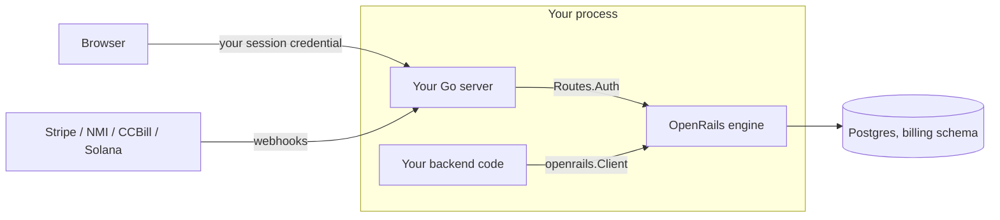

# Embedding OpenRails in your Go server

The full guide to running the OpenRails billing engine in-process;
`examples/embedded` is the runnable quickstart. Money is an integer in the
currency's native units (`GET /v1/config`'s `currencies`; micros for USD), a decimal string
on the wire ([money-wire.md](money-wire.md)). Vocabulary: a
**rail** is a gateway kind (`nmi` / `ccbill` / `stripe` / `solana`); a **PSP** is your
concrete account on a rail (e.g. `mobius` on nmi).

### 1. What embedding means

Your Go binary imports the engine and runs it in-process: no second service, no
network hop, no second credential. Concretely:

- The engine owns a configurable schema, defaulting to `billing`, inside **your** Postgres database.
- Its HTTP routes mount on **your** router under a prefix you choose; your users call
  them with their normal session credential.
- `openrails.New` returns the `*openrails.Engine`: the pool, the workers, the
  routes and every merchant in its directory. It has `Start`, `Close`,
  `Routes`, `RiverJobs`, `Ready` and `Probes`.
- A merchant's operations are on its handle, an `*openrails.Client`:
  `MerchantBySlug` for a merchant `Config.Merchants` declares, `Merchant(id)`
  for any live merchant in the engine's directory. It is the **same** type a
  standalone consumer gets from `openrails.NewRemote`. Parity is structural:
  one client implementation, one handler surface, joined by an in-process
  `http.RoundTripper` instead of a socket.
- A handle acts on its own merchant and no call names one. Holding the engine
  is the authority: an in-process handle carries no credential.
- An HTTP request acts on the merchant its credential is bound to, and nothing
  in the request names it ([merchant binding](merchant-binding.md)): the merchant whose AuthKit group the credential is
  bound to (its `BoundScope`, the group id being the merchant's id), else the
  merchant whose `Issuer` is the credential's issuer. A host serving one
  merchant with its own AuthKit declares that AuthKit's issuer on it:

  ```go
  merchant.Issuer = "https://shop.example" // your AuthKit's Token.Issuer
  cfg.Merchants = map[string]openrails.MerchantDeclaration{merchant.Slug: merchant}
  ```

  Its users are then the merchant's own customers and staff. A credential
  bound to no merchant is refused `403 merchant_unresolved`. Each merchant-bound
  answer names the merchant it acted on in `OpenRails-Bound-Merchant`.



### 2. Install and migrations

```bash
go get github.com/open-rails/openrails
```

The module versions its authentication and user-directory contracts with
AuthKit, importing only `authkit/auth` and `authkit/userinfo`. Those packages
use the standard library and link no AuthKit server or database implementation.
A host may implement the contracts itself or opt into AuthKit. A host imports
four kinds of OpenRails package; everything else is `internal/`:

| Package | Holds |
|---|---|
| `openrails` | `New` and its `*Engine`, `NewRemote`, the `*Client` handle, `Config`, `Deps` |
| `billing` | request/response types, IDs (`billing.MerchantID`, `billing.ParseMerchantID`), errors and codes |
| `catalog` | the catalog document (`catalog.Application`) and its charge models (rate cards, meters, prices) |
| `adapters/http`, `adapters/gin`, `adapters/fiber` | mount the routes an `openrails.Routes` selects on your router |

OpenRails owns its migrations: `New` applies them through your pool before
anything else touches the database. The pool's role owns the objects and is
the role OpenRails runs as (no grants); for another owner, have the pool's
connections `SET ROLE` to it.

`New` creates or upgrades OpenRails' tables in `cfg.Database.Schema`, River's
in `cfg.Database.RiverSchema` (`billing_river` for the default schema),
whichever fleet `Start` will run there, and this month's partitions. A host's
own AuthKit migrates itself in `authkit.New`. Replicas booting together take
turns on an advisory lock, and a migration that fails fails `New`, so new pods
crash-loop while the old ones keep serving. An older build boots against a
schema a newer one already migrated: migrations it does not know are left as
they are.

Billing, AuthKit, application tables and River may share `public` or another
namespace. OpenRails archives contain only billing-owned tables and never include
live River jobs, AuthKit identities or host records. `New` refuses to start
when an applied migration's file changed and the live schema no longer
matches a fresh build of it.

Merchant isolation uses verified application scope, explicit SQL predicates and
composite relationships, not PostgreSQL RLS. OpenRails creates no roles and
issues no grants.

### 3. Config and Deps

`openrails.Config` is plain data; `openrails.Deps` is everything the engine
reaches outside its process. Construction refuses to boot unless posture is
explicit:

| Config field | Required | Meaning |
|---|---|---|
| `TestMode` | yes | `openrails.Sandbox` or `openrails.Live`. The zero value is refused; it never silently means live. |
| `ProviderWriteMode` | yes | `ProviderWritesFull`, `ProviderWritesLimited` (renewals and retries wait) or `ProviderWritesReadOnly` (never charges). |
| `Database` | default `billing` | `Schema`: the Postgres schema of OpenRails' tables. `RiverSchema` (default `Schema` + `_river`): where OpenRails' River jobs live; `Start` runs them there, on its own client or the host's fleet (section 4). `New` creates or upgrades both. |
| `Merchant` | no | The merchant this engine serves (section 5). |
| `Catalog` | no | Optional startup batch, equivalent to calling `ApplyCatalog` once (section 5). Requires `Merchant`. |
| `Vault` | no | The Vault connection (or `Deps.Vault`). Its `KVMount` makes Vault the home of the merchant's configuration; without one, `Merchant` is. |
| `PublicBillingBaseURL` | for callbacks and links | External billing mount, excluding `/v1`. |
| `SMTP` | no | The built-in email sender: any SMTP server (`Host`, `Port`: 465 implicit TLS, else STARTTLS, 0 is 587; `Username`, `Password`; the deployment's `From`). SendGrid is `smtp.sendgrid.net` with username `apikey` and an API key as the password. Billing mail is sent from the merchant's profile `from_email` when it has one. Without it or `Deps.Email`, OpenRails sends no email. |

| Deps field | Meaning |
|---|---|
| `Postgres` | Your pool. Nil opens one from `Config.DB`. |
| `Redis` | Rate limits, admin lockouts, captcha challenges and card-testing declines shared by every instance, and abuse statistics. Without it they live in each process's memory: one instance only. |
| `Vault` | A borrowed Vault client. PSP secrets come from a declared merchant's PSPs or the secret store. |
| `ConsoleAssets` | A host-built admin console, which `Routes.AdminConsole` serves (section 6). |
| `Email` | Your own sender for OpenRails' rendered email; replaces `Config.SMTP` (set one). An empty `From` is the deployment's own mail. |
| `UserInfo` | Your directory (AuthKit's `ak.UserInfo()`, or your own `openrails.UserInfo`): who each customer is, asked whenever OpenRails emails or shows one. See [customer contacts](customer-contacts.md). |
| `StripeTransport`, `NMITransport`, `FXTransport`, `Clock` | Test seams, refused with `TestMode` live. |

`Deps` holds no auth: the engine authenticates nobody. Your auth guards the
routes you mount (section 6) and decides who may sign in; OpenRails keeps no
blocked list. A customer is your user's id; its email, username and name come
from `Deps.UserInfo`, or from your directory's SCIM pushes with
`RouteGroups.Programmatic`.

Under `Sandbox` every rail routes to its test environment and live credentials
refuse to boot. NMI accounts get an arm-time probe that refuses a conclusively
live gateway. See [operations.md](operations.md).

**Rate limiting is on by default**: a nil `RateLimits` gets the built-in limits
on checkout, card and subscription writes and webhooks (tight on checkout to
deter card testing; counted in Redis with `Deps.Redis`, else in the process's
memory, so several instances need Redis). Other routes are
not limited: a per-address ceiling belongs to your proxy. Override the limits,
or set `RateLimitsDisabled` if your own gateway fronts billing. See
[rate-limiting.md](rate-limiting.md).

### 4. Boot, lifecycle and River

```go
bill, err := openrails.New(ctx, cfg, openrails.Deps{Postgres: pool})
if err != nil { return err }
defer bill.Close(ctx)
client, err := bill.MerchantBySlug(cfg.Merchant.Slug) // your merchant's handle: every billing operation
if err != nil { return err }
```

Only Postgres (including the migrations `New` applies first) and a refused
`MerchantDeclaration.Catalog` can fail `New`; it starts no workers. A catalog
naming a declared PSP whose account waits on Vault (a Transit signer before the
first login) is applied in the background once Vault answers; `Ready` fails,
naming it, until then. Vault login, PSP posture checks and Redis reconnect in the background
(capped full-jitter backoff, forever); until then only their features answer
503. `Ready` is the readiness check (Postgres, the merchant directory, the
declared catalog, River). Register `Probes` with the host's
`github.com/open-rails/helpers/deps` supervisor:

```go
for _, p := range bill.Probes() { // openrails_vault, openrails_psp_posture, openrails_job_progress, ...
    sup.Add(p.Name, deps.Optional, p.Check, nil)
}
```

River is required: renewals, dunning, usage orders, reconciliation and provider
intents are River jobs. Jobs queue in `Config.Database.RiverSchema` from `New`
on and wait there; `Start` runs them, and `Ready` fails until it does. Without
options `Start` builds and runs OpenRails' own River client there:

```go
if err := bill.Start(ctx); err != nil { return err }
```

A host that already runs a River fleet adds OpenRails' jobs to it, beside its
own and AuthKit's, and passes the fleet to `Start`. The fleet must use
`Config.Database.RiverSchema`, where `New` created River's tables:

```go
workers, err := riverhelpers.New(ctx, pool, &river.Config{
    Schema: "billing_river", // Config.Database.RiverSchema
    Queues: map[string]river.QueueConfig{openrails.QueueBilling: {MaxWorkers: 10}},
}, auth.RiverJobs(), bill.RiverJobs())
if err != nil { return err }
if err := workers.Start(ctx); err != nil { return err }
defer workers.StopAndCancel(context.WithoutCancel(ctx))
if err := bill.Start(ctx, openrails.WithRiverClient(workers)); err != nil { return err }
```

OpenRails enqueues through the host's fleet and never starts or stops it.
Composing `RiverJobs` into a fleet in another schema is refused. Once
`RiverJobs` went to a fleet, `Start` without `WithRiverClient` is refused, and
`WithRiverClient` refuses a fleet built without this engine's `RiverJobs`; a
second `Start` is refused too. Cancelling `Start`'s context stops nothing:
`Close` stops what `Start` started; close the engine before the pool. OpenRails
also watches the fleet from outside River: `openrails_job_progress` fails while
it is stalled.

**Inserting an engine job.** The one job a host inserts itself is the usage
sweep: `workers.Insert(ctx, openrails.UsageSweepArgs{FinalizePreviousMonth: true}, nil)`
bills the previous period of every customer active in it now; `Collect: true` runs the
collection pass. Runs are idempotent.

**No job clock.** `river.Config.JobTimeout` does not apply to OpenRails'
workers: each declares `Timeout() = -1` and ends on observed lack of progress
(3x its cadence, floored at 30 min). A running job beats
`river_job.attempted_at`, so `RescueStuckJobsAfter` measures silence from a dead
process, never the age of a live job.

### 5. Declaring the merchant

Each entry of `Config.Merchants`, keyed by slug, is create-if-missing,
reconcile-if-present on every boot, before routes or workers can observe it.
`Issuer` and `Catalog` are set in your code, never in a merchant file: an
issuer belongs to one merchant of an engine, and `New` refuses one declared
twice. The fields are the merchant manifest's
(same shape as `config/merchants_config.example.yaml`). `Settings` is the
`billing.MerchantSettings` document the configuration API reads and applies:
one shape, one validator, in YAML and over the API.

```go
cfg.Merchant = openrails.MerchantDeclaration{
    Slug:        "myapp",
    DisplayName: "My App",
    Settings: billing.MerchantSettings{
        Profile:                &billing.MerchantProfile{FromEmail: "billing@myapp.example", SupportURL: "https://myapp.example/support"},
        BillingPeriodBoundary:  "calendar_month",
    },
    PSPs: map[string]openrails.PSPConfig{ // PSP key -> account
        "my-nmi-sandbox": openrails.NMIPSP{
            AccountID:            "000000", // NMI dashboard "Gateway ID"
            TokenizationKey:      "placeholder-tokenization-key",
            SecurityKey:          "placeholder-security-key",
            WebhookSigningSecret: "placeholder-webhook-secret",
        }.PSPConfig(),
    },
}
```

`client.MerchantID()` is the declared merchant's ID (`client` is its handle,
`bill.MerchantBySlug`). A host builds the
declaration from its own configuration (koanf, kong, flags), or keeps it in a
YAML file: `openrails.ReadMerchantFile(path)` reads one merchant strictly
(unknown fields refused; `openrails.ParseMerchantDeclaration` takes the bytes).
The file names its merchant with a required top-level `slug:`; a standalone
manifest keys each merchant by slug instead and refuses the field inside an
entry. `MerchantDeclaration` and `PSPConfig` carry `yaml` tags, so they
can also sit inside the host's own YAML config. The file holds PSP secrets: keep
it out of version control.

In Go, `openrails.NMIPSP`, `StripePSP`, `CCBillPSP` and `SolanaPSP` name each
rail's slots as fields, so a misspelled one fails to compile; `PSPConfig()`
returns the declaration, and an empty field is an omitted key. A PSP missing a
required secret is declared but not armed, in Go as in YAML.

| Rail | Secrets (required first) | Settings |
| --- | --- | --- |
| `stripe` | `secret_key`, `webhook_signing_secret`; `webhook_signing_secret_thin`, `webhook_signing_secret_previous` | `publishable_key`, `webhook_overlap_expires_at` |
| `nmi` | `security_key`, `webhook_signing_secret`; `webhook_signing_secret_previous` | `tokenization_key`, `tokenization_url`, `endpoint_deployment`, `card_entry`, `webhook_overlap_expires_at` |
| `ccbill` | `salt`; `datalink_username`, `datalink_password` | |
| `solana` | `private_key` (or `signer: {mode: vault_transit, key: …}`) | `rpc_provider`, `rpc_api_key`, `tokens`, `recipient_wallet` |

A `settings` or `secrets` key outside its rail's row, in YAML or in a
`PSPConfig` built by hand, is refused by the parser and by `openrails.New`,
naming the PSP, the key and the keys the rail takes. A standalone manifest
refuses it the same way.

The merchant's configuration lives in `Config.Merchants` or in Vault, never in
the database ([merchant configuration](merchant-configuration.md)). Declared in
`Config.Merchants`, it is read at `New` and is read-only: change the declaration
and construct a new engine. With `Config.Vault.KVMount` named, Vault holds it:
the declaration names the merchant, its `Issuer` and `Catalog` (declaring
configuration is refused),
and `Client.UpdateMerchantConfiguration`, `CreatePSP`, `UpdatePSP`
and the alert-webhook methods edit it at the revision they read
([vault.md](vault.md)). `RouteGroups.MerchantConfig` publishes those routes
with the rest of the merchant's configuration; the edits mount only with
Vault. Imported billing facts attributed to a PSP without credentials need its
identity first: `client.DeclarePSP(ctx, billing.PSPDeclaration{...})`
during setup.

**Startup catalog batch:** read a YAML or JSON document with `catalog.ReadFile`
and set it as `MerchantDeclaration.Catalog`; `New` applies it on every start, like calling
`client.ApplyCatalog(ctx, document, billing.ApplyCatalogParams{})`. Documents
and individual edits (the console, the catalog routes, the client's edit
methods) share the merchant's catalog: a document skips a product, price or
meter whose field an edit set differently, reports it, and applies the rest
([catalog ownership](catalog-ownership.md)). A conflict never fails `New`.

The server computes a canonical content hash and commits it with a batch that
applied whole. That document replays forever, even after intervening API edits
or an archive restore. Concurrent applications of identical content commit once.
Failed batches, and batches that skipped an object, are not marked applied. No caller `application_id`, `expected_revision`, or
`catalog_version` is needed or accepted. Hashes deduplicate; they do not order
previously unseen batches. Intentionally restoring old state requires a new
operation rather than replaying an already-applied document.

Omitted products, prices and fields keep their stored values. Use `archived: true`
to retire an entry and `archived: false` to restore it. `prune: true` explicitly
opts into archiving omitted products/prices that only documents set; no catalog
operation deletes them.
The apply makes no provider writes. It may read a provider to verify an explicit
reference. `MerchantDeclaration.Catalog` can finish a temporarily unavailable provider check in
the background, with `Ready` failing until that startup batch succeeds.

**Catalog authoring**: storage is always the database.
An engine's handle is the process owner and writes its catalog directly
(`ApplyCatalog`, or `CreateProduct`, `CreatePrice`, `UpdatePrice`);
`RouteGroups.Catalog` publishes catalog changes to HTTP and delegated
callers. YAML is decoded into the same `catalog.Application` as JSON
(`catalog.ReadFile`, `catalog.ParseApplicationYAML`).
Omitted records survive by default; explicit `archived: true` retires a known
record, and `prune: true` archives omitted products and prices that only
documents set. Price keys are unique within their product. Key lookups and checkout selections
therefore carry both `product_key` and `price_key`; price IDs select one immutable
record directly. Each product/key chain has automatic price revisions starting at
zero. New financial terms create a new revision; repeating or reactivating old
terms reuses their original ID and revision. Keys, terms and product association
are immutable; products and prices can be archived but never deleted. Changing a
price never silently reprices existing subscriptions. For dynamic products with host-owned Stripe credentials declare
the account in `Config.Merchants`; rotate by updating it and constructing a new engine.

### 6. Authentication and HTTP

OpenRails has no logins of its own, and you write no middleware for it. You
supply your auth only when you mount routes, as `Routes.Auth`: an
`openrails.Authenticator` (authkit/auth's), which only says who a request is.
OpenRails asks it once per request and builds every gate from its answer, a
`Verified`:

| Call | OpenRails asks it |
|---|---|
| `Authenticate(r)` | on every customer, staff and programmatic route and the access read, once |
| `Verified.Identity()` | who it is: a person or an application, acting itself or for someone |
| `RootScope(ctx)` (`auth.Root`) | where your staff hold `root:` permissions; needed with any route group on |
| `Verified.Can(scope, permission)` (`auth.PermissionChecker`) | on every staff and programmatic route, with the route's permission: its `merchant:` name in the merchant's own scope (`{Authority: RootScope's, ID: the merchant's id}`), else its `root:` name in `RootScope`, checked live; without it the request holds nothing |
| `Verified.CheckRecentSignIn()` (`auth.RecentSignInChecker`) | on customer-network routes marked `sensitive` in [routes](api/routes.md). Staff routes do not request a recent sign-in, including when called with a personal API key |

OpenRails answers every refusal itself, with the status and challenge
`auth.Refuse` gives every consumer: 401 with `WWW-Authenticate` for a missing,
invalid, expired or revoked credential (your `auth.Challenge` headers win), 403
for a permission not held, 503 `authentication_unavailable` or
`authorization_unavailable` when your auth cannot answer. A sensitive
customer-network route answers a stale sign-in with RFC 9470's step-up: 401 `step_up_required` with `WWW-Authenticate: Bearer
error="insufficient_user_authentication", max_age=...` and your challenge's
metadata. An identity without a subject or invoker is refused, so an
Authenticator that checks nothing admits no one. Each handler checks the
verdict again before it runs.

`Identity` returns an `openrails.Identity` in three parts:

- `Subject` (with `SubjectKind`, `openrails.SubjectUser` or
  `openrails.SubjectApplication`) is the native account acted as. On a
  customer route it is the customer: a canonical UUID, the same user whatever
  credential they signed in with. A staff permission is the subject's.
- `Invoker` is the party actually acting: `{Issuer, Subject}` when the subject
  acts itself, else whoever acts on its behalf, possibly another issuer's user
  spending the subject's balance. Spend limits and staff rate limits key on
  it (`issuer|id` when another issuer vouches for it). An invoker acting for
  someone else, or an application subject, calls no `/v1/me` route.
- `Credential` is how it was proven: `openrails.CredentialSession`,
  `CredentialDeviceKey`, `CredentialAPIKey`, `CredentialSignedToken` or
  `CredentialAccessToken`, with its id for audit. Only a user acting in person
  (not with an API key or signed token) starts a payment for itself.

You name no permission and no scope: you turn route groups on in
`Routes.RouteGroups`, and each route checks its own permission, one of
`billing.Permissions()`. Declare those names in your RBAC from the constants
and grant them to roles, as [auth](auth.md#permissions) lists:
`root:customer:read`, `root:customer:manage`, `root:catalog:manage`,
`root:config:manage`, `root:metrics:read`, `root:entitlements:read`,
`root:catalog:read`, `root:usage:manage`, `root:events:read`,
`root:orders:manage`, and each one's `merchant:` twin
(`merchant:customer:read`, …) for staff of one merchant alone. The admin
group's reads need `root:customer:read` and its updates `root:customer:manage`
(each route's level is OpenRails'; read-only staff hold a role with the read
alone), the catalog `root:catalog:manage`, the merchant's own configuration
`root:config:manage` and the business metrics `root:metrics:read`. A group
that is on mounts all its routes.
The programmatic routes your backend calls over HTTP (`/v1/app/*`,
`RouteGroups.Programmatic`) admit the application your `Auth` says a request
is, by its `Identity.SubjectKind`, holding the route's permission, and refuse
a person: `root:entitlements:read` for the content gate, `root:usage:manage`
for admissions, usage events and running charges, `root:events:read` for host
events, `root:orders:manage` for orders
(`root:customers:read` finds a customer by openrails.dev account, only where
the [customer network](customer-network.md) runs). Give a program a role
holding only what its task needs.
With any route group on, `Auth` is a authkit/auth `Root`, as
`ak.Authenticator()` is: its `RootScope` is AuthKit's root group, and a
merchant's own scope is the AuthKit group whose id is the merchant's. `Mount`
fails for a route neither of whose names your Authenticator knows
(`auth.PermissionCatalog`), and never asks a name it does not know, so a host
that grants only root roles declares the `root:` names alone. A host with its
own sessions implements `Authenticate`, `RootScope` and its `Verified`
directly (the README's "Using your own auth"); its `Identity` must name a
person `SubjectUser` and an application's credential `SubjectApplication`,
since the programmatic routes refuse a person whatever it holds.
`openrailstest.CheckAuth(t, routes, authtest.Cases{...})`
checks an implementation in your CI with helpers' conformance kit
(`github.com/open-rails/authkit/auth/authtest`): anonymous, refused, staff, a
user holding nothing, one-permission holders, a stale sign-in and your
application, each of the route groups' `root:` permissions in exactly your
`RootScope`, and staff signed out last; it fails on any acceptance or mix-up,
and on a person whose subject is not a canonical UUID.

An `openrails.Routes` selects the routes the engine's `Routes` returns; mount them
on your root router with the adapter for it. Validation happens here: a mount
without `Auth` fails before anything is registered, so nothing is ever served
open.

```go
routes := openrails.Routes{Auth: ak.Authenticator(), Prefix: "/billing"}
// net/http or Chi: github.com/open-rails/openrails/adapters/http
if err := openrailshttp.Mount(mux, bill, routes); err != nil { return err }
// Gin: github.com/open-rails/openrails/adapters/gin
if err := openrailsgin.Mount(r, bill, routes); err != nil { return err }
// Fiber v3: github.com/open-rails/openrails/adapters/fiber
if err := openrailsfiber.Mount(app, bill, routes); err != nil { return err }
```

| `Routes` | Exposed surface |
|---|---|
| `Prefix` | Where the API lives: `/billing` serves `/billing/v1/*`; empty is the root |
| (always) | The public configuration (`GET /v1/config`: what this mount serves and the currency registry), the public catalog (`?merchant=<merchant id>`), Solana Pay, the customer routes (`/v1/me/*` at the customer's merchant, orders and the merchant's payment setup included) and signature-checked provider callbacks |
| `Auth` | Your auth (above); required. An order is read and paid only by its own customer, admitted by it |
| `RouteGroups.Admin` | Customer support (`/v1/admin/*`) at the credential's merchant: payments and refunds, subscriptions, orders, credits, access, usage; reads need `root:customer:read`, updates `root:customer:manage` |
| `RouteGroups.Catalog` (`/v1/catalog`, `/v1/catalog/price-migrations`) | The catalog: products, prices, meters and their rates, archiving a product, applying a catalog document, price migrations; needs `root:catalog:manage`. With a declared merchant's `Catalog`, the file skips what an edit changed |
| `RouteGroups.MerchantConfig` (`/v1/merchant`) | The merchant's own configuration: PSPs and pulling their state again (`RefreshPSPs`), reading and resolving findings, settings, billing import and export, the dashboard layout; needs `root:config:manage` |
| `RouteGroups.Metrics` | Business metrics, read-only: the metrics queries and the dashboard; needs `root:metrics:read` |
| `RouteGroups.Programmatic` | Your backend's routes (`/v1/app/*`): the content gate, offers, usage events and admissions, running charges, host events and SCIM provisioning. They refuse a person; each needs its own permission (`root:entitlements:read`, `root:catalog:read`, `root:usage:manage`, `root:events:read`, `root:orders:manage`; SCIM needs none); each write takes an `Idempotency-Key`. In process, the `Client` calls them without it |
| `AdminConsole` | The staff dashboard at `Prefix`'s `/admin`, for the one merchant whose `Issuer` you declare; needs a staff group on. Over several merchants bound by group, `Mount` refuses it |
| `AdminConsoleAuthBase` | Where your AuthKit's JSON API is mounted on the same origin, AuthKit's `APIBase()`; the console signs staff in there. Empty is `/api/v1` |

The customer surface, `/v1/me`, serves each customer at its merchant. Every customer route
acts only on the admitted subject: no path, query or body names a customer, and
another customer's resource reads exactly like a missing one. Ambient cookies
never reach your `Auth`: a browser call carries its credential in a header.

Each adapter registers ordinary method and path routes, so route inspection
sees the real endpoints and unrelated paths keep the host's 404/405 behavior.
Original request URLs and bodies reach authentication and webhook verification
unchanged. One selection is materialized once, so remounting it never resets
rate limits.

**Admin console** (optional): `Routes.AdminConsole` mounts the staff
dashboard at `Routes.Prefix`'s `/admin`, beside the routes it drives, and signs
staff in through your AuthKit's JSON API on the same origin: at
`Routes.AdminConsoleAuthBase` (pass AuthKit's `APIBase()` when its `APIPath` is
not the default), else `/api/v1`. It
needs a staff group on and a console build (`Deps.ConsoleAssets`); `Mount` fails
without either. Each area appears only to staff holding its group's permission
(`GET /v1/admin/access`): customer support, read-only without `root:customer:manage`;
the catalog; the PSP, findings, settings and notification pages; and the metrics
dashboard, whose layout editing also needs `MerchantConfig`.
See [admin-console.md](admin-console.md).

### 7. Calling the engine

```go
if err := bill.Ready(ctx); err != nil { return err } // fail fast at boot
```

The merchant's handle, the shared concrete `*openrails.Client`, grouped by job:

| Group | Methods |
|---|---|
| Admission (hot path) | `Admit`, `CaptureAdmission`, `ReleaseAdmissions`, `ExtendAdmissions` |
| Usage | `RecordUsage` (metered events outside the hold/capture cycle, failed usage included); reports through `QueryMetrics` |
| Configuration | `GetMerchantConfiguration`, `UpdateMerchantConfiguration` |
| Credits | `CreateCreditGrants`, `ListCreditGrants`, `GetCreditGrant`, `RevokeCreditGrant`, `ListBalanceTransactions`, `GetBalance` |
| Customers / entitlements | `ListCustomers`, `GetCustomer` (contact, settings, balances, default cards), `UpdateCustomer` (credit limits, trust levels, billing policy, invoice profile), `CheckEntitlements` (programmatic), `ListEntitlements`, `ListProductAccess`, `CreateProductAccess`, `RevokeProductAccess` |
| Catalog (API hosts) | `ListOffers` (programmatic: what a customer may buy, by entitlement or product key), `ApplyCatalog`, `CreateProduct`, `GetProduct`, `ListProducts`, `UpdateProduct`, `CreatePrice`, `GetPrice`, `ListPrices`, `ListPriceHistory`, `UpdatePrice`, `ListMeters`, `GetMeter`, `SetMeter` (with its rate card) |
| Subscriptions | `GetSubscription`, `ListSubscriptions`, `CancelSubscription`, `ResumeSubscription`, `ChangeSubscription`, `PreviewSubscriptionChange`, `SetSubscriptionPaymentMethod`, `CreatePriceMigration`, `PreviewPriceMigration`, `ListPriceMigrations`, `GetPriceMigration`, `CancelPriceMigration` |
| Orders | `CreateOrder`, `PreviewOrder`, `CancelOrder` (merchant orders: unpaid orders a customer pays on your site); `ListOrders`, `GetOrder` (staff read); `VoidOrder`, `MarkOrderUncollectible`, `RetryOrderCollection` (usage orders). Only the customer pays with a card they enter |
| Payments | `GetPayment`, `ListPayments`, `CreatePayment` (money received outside OpenRails), `RefundPayment`, `ListPaymentAttempts`, `GetPaymentAttempt`, `ListRenewals`, `GetRenewal`, `ListPaymentMethods` |
| Running charges | `StartRunningCharge`, `StopRunningCharge`, `GetRunningCharge`, `ListRunningCharges` |
| Host feed / import | `ListHostEvents`, `AcknowledgeHostEvents`, `ImportBilling` |

```go
verdicts, err := client.Admit(ctx, []billing.AdmitParams{{
    RequestID:       requestID, // idempotency key
    CustomerID:      billing.CustomerID(customerID), // the host's subject UUID
    Invoker:         userID,
    InvokerType:     billing.InvokerTypeDelegated,
    Currency:        "USD",
    EstimatedAmount: 50_000,    // native units (USD: micros)
    ExpiresAt:       &deadline, // required with a hold: the job's deadline
}})
receipt, err := client.CaptureAdmission(ctx, requestID, billing.CaptureAdmissionParams{
    Amount: 43_000, Usage: &billing.CaptureUsage{EventType: "chat.completion"},
})
held, err := client.ListEntitlements(ctx, billing.EntitlementListParams{
    CustomerIDs: []billing.CustomerID{billing.CustomerID(customerID)}, Entitlements: []string{"premium"},
}) // held.Items is empty when the key is not held
```

Entitlement checks address customers by the ids your auth system already holds;
a customer who never touched billing holds no keys, never an error. Deny verdicts are `(Allowed=false, nil
error)`.

`New` takes no options. An in-process call runs as long as its context
allows: bound it with the context's deadline.

Orders and their previews use the shared client too. See
[checkout](api/commerce.md).

A host that must start or stop a running charge in the same commit as its own
rows uses its engine handle's `StartRunningChargeTx` and `StopRunningChargeTx`
with a transaction from its pool. See [running charges](running-charges.md).

One engine serves every live merchant in its directory, each through its own
handle. `Merchant` reads nothing and refuses only the zero ID; each call reads
the merchant from the directory, so one provisioned while the engine runs is
served at once, and an unknown, deleted or archived one answers
`403 merchant_unresolved` (`billing.ErrMerchantUnresolved`):

```go
storeB, err := bill.Merchant(storeBID) // a billing.MerchantID your host keeps
if err != nil { return err }
products, err := storeB.ListProducts(ctx, billing.ProductListParams{})
```

Handles share the engine's pool and workers; make one per call or keep it.

### 8. Hosted products

The library serves the merchants its host declares, behind the host's own auth.
A product that serves many merchants with OpenRails' own accounts (merchant
sign-up, teams, merchant API keys, trusted issuers, fleet analytics) builds on
`github.com/open-rails/openrails/server` instead, its own module released with
this one, which composes this engine with its own AuthKit like any host does; see
[standalone-integration.md](standalone-integration.md#building-on-the-server-package).

### 9. Acting on delinquency

For arrears billing, OpenRails decides when a customer's unpaid debt has outlived
the merchant's grace window and refuses their new spend at admission — but only
your app can shut off what your app runs. Transitions land on a durable,
acknowledged feed you drain:

```go
// client is a merchant's handle, from an Engine or a Remote; both have the same operations.
for _, kind := range []billing.HostEventType{
    billing.HostEventDelinquencyGrace,
    billing.HostEventDelinquencyEntered,
    billing.HostEventDelinquencyCleared,
} {
    page, err := client.ListHostEvents(ctx, billing.HostEventListParams{
        Type: kind, PageRequest: billing.PageRequest{Limit: 100},
    })
    if err != nil { return err }
    var done []billing.HostEventID
    var failed error
    for _, event := range page.Items {
        if failed = applyHostAction(ctx, event.Type, event.Delinquency); failed != nil {
            break // leave this and later events pending for replay
        }
        done = append(done, event.ID)
    }
    if len(done) > 0 {
        if _, err := client.AcknowledgeHostEvents(ctx, done); err != nil { return err }
    }
    if failed != nil { return failed }
}
```

Ack after your action is durable — an unacked event is redelivered. OpenRails
never revokes an entitlement for an unpaid arrears bill. Full boundary and policy:
[arrears-delinquency.md](arrears-delinquency.md).

### 10. Webhooks and ops

Point each rail's webhook at the webhook routes on **your** server, under your mount
prefix (`/v1/webhooks/{rail}/{account_id}`; see [the API guide](api/endpoints.md#provider-webhooks)). OpenRails verifies rail
signatures and updates subscriptions/entitlements; your app just reads the results.
Local rail sandboxes: [dev/local-webhooks.md](dev/local-webhooks.md). In your
end-to-end tests, `openrailstest/nmimock` stands in for NMI and
`openrailstest/stripemock` for Stripe on loopback (see [NMI](rails/nmi.md#sandbox-testing)
and [Stripe](rails/stripe.md#sandbox-testing) sandbox testing).

Customers' emails and names come from `Deps.UserInfo`, asked on every read. A
host that keeps a pushed copy instead leaves `UserInfo` out, turns on
`RouteGroups.Programmatic` and points its directory at
`{Prefix}/v1/app/scim/v2` with an application credential or a provisioning
token (`client.CreateProvisioningToken`); a directory in the same binary pushes to
`client.SCIMHandler()` with no token. In tests, `openrailstest.UserInfo` is an
in-memory `openrails.UserInfo`. See [customer contacts](customer-contacts.md).

Further reading: [operations.md](operations.md) (operating modes, safety levers,
dunning, the intents ledger), [billing-policies.md](billing-policies.md)
(named spend/credit-line policies and how you bind them),
[arrears-delinquency.md](arrears-delinquency.md),
[rate-limiting.md](rate-limiting.md),
[auth.md](auth.md) (the full one-credential-per-trust-domain rationale),
[self-hosting-mode1.md](self-hosting-mode1.md).


OpenRails serves no team or API-key routes: the host owns its identity and
team UI. Worker health is the engine's `Probes` (`openrails_job_progress`).

### Merchant checkout authority

A customer usually buys with their own credential: their browser creates and
pays an order at `/v1/me/orders`. `Client.CreateOrder` creates an unpaid order
for them with the merchant's credential instead, in process or remote with an
application key holding `root:orders:manage`, for a host whose own purchase
rules decide what a customer may buy. Either way only the customer pays it,
signed in (billing-ui's `<OrderCheckout orderId>`): staff never buy for
someone else.
