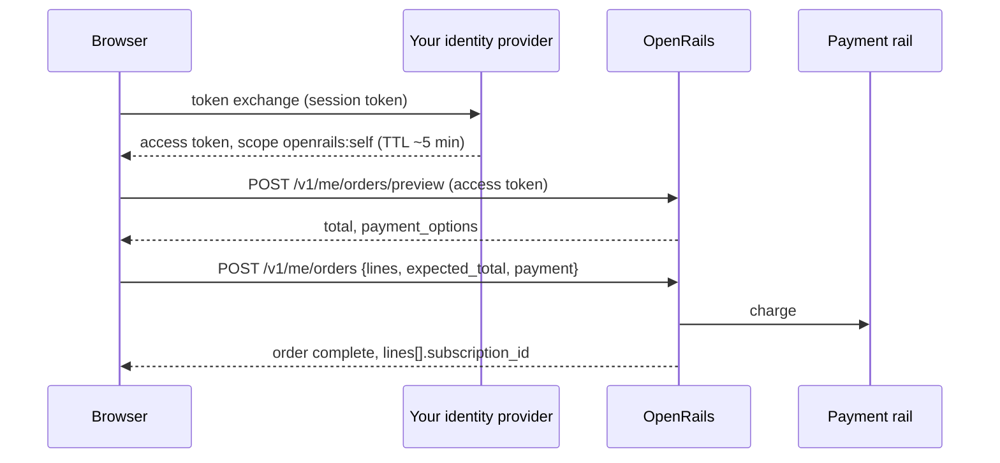

# Frontend Integration Guide

How to build billing UI against OpenRails from the browser. Applies to all three
deployment shapes:

- **Embedded** — OpenRails runs inside the host's Go server; billing routes are mounted
  on that server under a prefix (e.g. `/billing/v1/*`).
- **Standalone** — OpenRails is its own HTTP service; the browser calls it directly.
- **SaaS (hosted)** — identical to standalone from the browser's perspective; everything
  below that says "standalone" applies unchanged.

Money amounts are integers in the currency's native units (micros for USD:
`$5.00 = 5_000_000`), carried as decimal strings — parse with `BigInt`, never
`Number` ([money-wire.md](money-wire.md)).
A **rail** is the gateway kind (`nmi`, `ccbill`, `stripe`, `solana`); a **PSP** is the
merchant's account on a rail, named by its key (`mobius` = an NMI account). An order
lists its `payment_options`, one per PSP that can sell its lines, in the merchant's
routing order; the page pays with one of them ([Orders](#orders)).

### Authentication

Every call acts on the merchant its token is bound to, and the browser names
no merchant ([merchant binding](merchant-binding.md)). Embedded applications
use their normal user credential through the host's auth, sent in a header:
the mount strips ambient cookies. AuthKit's own auth routes keep their
refresh/CSRF cookie protocol.

Standalone and SaaS browser clients call OpenRails with an OAuth 2.0 access
token (RFC 9068 `at+jwt`) from an issuer the merchant trusts ([auth](auth.md#trusted-issuers)):

1. Get an access token for OpenRails' resource identifier with scope
   `openrails:self` from your issuer: an authorization-code flow, or an RFC 8693
   token exchange of the user's session token. AuthKit's `@openrails/auth-ui`
   issuer client does both. A trusted application without an authorization
   server redeems its own assertion at the server's token endpoint instead.
2. Call OpenRails with the token in `Authorization`. A 401 carries the server
   AuthKit's challenge headers; a sender-constrained token's client answers
   them as AuthKit documents
   ([DPoP](https://github.com/open-rails/authkit/blob/master/docs/resource-server.md#dpop)).
3. Clear the token on sign-out or account change; refresh before expiry. Do
   not automatically repeat a financial mutation without its documented
   durable operation key.

billing-ui keeps that token for you. `tokenSource({ fetchToken, skew })` is a
`getToken` for `createBillingClient`: it asks your `fetchToken` for
`{ access_token, expires_in }`, keeps the token in memory (never in browser
storage) until `skew` seconds before it expires (60 by default), and fetches
the next one with a single request however many calls are waiting. A call
answered 401 `credential_expired` is sent once more with a new token; the
gate refused it before the route ran, so this is safe for a write too.

```ts
import { createBillingClient, redeemAssertion, tokenSource } from "@openrails/billing-ui"

const billing = createBillingClient({
  baseUrl: "https://billing.example/v1",
  getToken: tokenSource({
    // Your backend signs an assertion for the signed-in customer; the browser redeems it.
    fetchToken: async () => {
      const { assertion } = await (await fetch("/api/billing/assertion", { method: "POST" })).json()
      return redeemAssertion({ tokenEndpoint: "https://billing.example/oauth2/token", assertion })
    },
  }),
})
```

`redeemAssertion` posts the RFC 7523 grant (`scope=openrails:self`) with the
`fetch` you give it; one that adds a DPoP proof (auth-ui's `dpopFetch`) binds
the token to the browser's key. A backend that redeems the assertion itself
answers `fetchToken` the token response directly.

Self-service CORS allows any origin without credentials (`credentials: "omit"`)
and exposes the headers the server's AuthKit advertises.

### The self-service surface: `/v1/me/*`

Every route is scoped to the token's own subject (`sub` standalone, your
session identity embedded). There is **no `:user_id` anywhere** — a browser credential
can only ever act on itself. In embedded mode, prepend the mount prefix to every path.

```
GET  /v1/me                               balances, default cards, unread notices
GET  /v1/me/balance/transactions?currency=USD  balance transactions, newest first
GET  /v1/me/usage?currency=USD            metered usage by event type (or ?group_by= resource, invoker, meter), largest first (cursor page)
GET  /v1/me/orders[/{id}]                 purchases, renewals and usage orders (cursor page)
GET  /v1/me/payments                      payment and refund history (cursor page)
GET  /v1/me/entitlements                  active entitlements
PUT  /v1/me/default-payment-methods/{currency}  body {"payment_method_id"}: the card that pays a currency
GET  /v1/me/subscriptions[/{id}]          own subscriptions (cursor page): typed ids, price/product, scheduled change, card, access
POST /v1/me/subscriptions/{id}/cancel      body {"reason": "..."} → the Subscription (next_action when the wallet must sign)
POST /v1/me/subscriptions/{id}/resume      undo a scheduled cancel → the Subscription
POST /v1/me/subscriptions/{id}/change body {"price_id":"price_...", "quantity": 3} → a SubscriptionChange (plan or seats)
PUT  /v1/me/subscriptions/{id}/payment-method  its own saved card, or null to follow the default → the Subscription
GET|POST /v1/me/payment-methods           list (cursor page) / add a card with a PSP
PATCH|DELETE /v1/me/payment-methods/{id}  edit expiry, billing details, reuse / provider-aware delete
POST /v1/me/orders[/{id}/pay]             buy priced lines, or pay an open order
POST /v1/me/stripe/billing-portal-sessions → {"url": ...} Stripe's portal (merchants with a Stripe PSP)
GET  /v1/me/config                        the merchant's payment setup and name
GET  /v1/me/notifications                 billing notifications
```

`GET /v1/me/usage` is a page of the customer's usage in one currency over
`from`..`to` (RFC 3339 or a date; the month before now by default), grouped
by `event_type`, `resource` or `invoker`: `rows` by total amount, largest
first, then by key. `limit` is 1 to 1,000 groups (default 100), and
`next_cursor` reads the next page, null on the last. A cursor reads only the
report it came from: another currency, grouping or window is `400
invalid_cursor`, and a window the request leaves out is the cursor's.
billing-ui's `getUsage` sends it.

The public catalog needs no auth and is a lookup by product key in one
merchant's catalog:
`GET /v1/products?merchant=<merchant id>&keys=course-101&keys=course-bundle`
returns each named product that merchant has on sale, with its current prices,
in one page. It reads no credential, so `merchant` is required signed in or
out: one merchant id (not its name), else `400 invalid_query`; `404
resource_not_found` when no live merchant has it. It takes `keys` beside it, 1
to 100 of them: no entitlement filter, no listing, and any other parameter is
`400 invalid_query`. billing-ui's `<BuyButton merchant>`, `<ProductList merchant
keys>` and `listProducts({ merchant, keys })` send it. Which products to sell
is your server's call: the Go `Client.ListProducts` (`GET
/v1/catalog/products`) filters by product keys or entitlements; use
`Archived: new(false), ForSale: new(true)` for products on sale. Every product
includes its current prices.

### Configuration: `GET /v1/config` and `GET /v1/me/config`

`GET /v1/config` is the deployment's: public, unauthenticated, always mounted,
the same for every caller and cacheable (`Cache-Control: public, max-age=300`
with an `ETag`). It holds the mount's `capabilities`, the currency and rail
registries (`currencies`, `rails`), the `captcha` to solve when a request
answers 403 `captcha_required` (null when none is configured) and the customer
network's sign-in (`network`). It names no merchant.

`GET /v1/me/config` is the merchant's, for a credential bound to that merchant:
a customer's token, or a checkout URL's secret on the checkout host. It holds
`merchant` (its `display_name`, https `logo_url` and `support_url`, and
`embed_origins`) and `payment`, which answers "what can this merchant take
money with, and what do I need in the browser to do it?" so you never hard-code
a rail or duplicate a tokenization key in your own config. It is `Cache-Control:
private`. An order carries its own `payment_options`; `payment` is what the page
loads to take a card. `@openrails/billing-ui` reads each document once and shares
it (`useConfig()`, `useCustomerConfig()`): `OrderCheckout`, `AccountBilling` and
`PaymentMethodsPanel` take their PSPs from the second.

`payment` looks like this:

```json
{
  "psps": [
    { "psp_id": "psp_...", "key": "mobius", "rail": "nmi", "custodian": "psp", "display_name": "Credit Card",
      "flow": "tokenize", "checkout": true,
      "config": { "tokenization_key": "<public Collect.js key>",
                  "tokenization_url": "https://secure.networkmerchants.com/token/Collect.js" } },
    { "key": "mobius-bt", "rail": "nmi", "custodian": "basis_theory", "display_name": "Credit Card",
      "flow": "tokenize",
      "config": { "public_api_key": "<public Basis Theory application key>" } },
    { "key": "stripe", "rail": "stripe", "custodian": "psp", "display_name": "Stripe",
      "flow": "elements", "checkout": true, "config": { "publishable_key": "pk_test_..." } },
    { "key": "ccbill", "rail": "ccbill", "custodian": "psp", "display_name": "Credit Card", "flow": "redirect" },
    { "key": "solana", "rail": "solana", "custodian": "psp", "display_name": "Solana", "flow": "wallet" }
  ]
}
```

- Only **armed** PSPs appear — a rail the merchant has no live account on is simply
  absent. Switch on `flow`, not on a hard-coded list of rails:
  - `tokenize` — load `config.tokenization_url`, tokenize with `config.tokenization_key`,
    POST the resulting token.
  - `elements` — Stripe with a declared `publishable_key`: Stripe Elements makes a
    `pm_` (`createPaymentMethod`), which an order's `payment.token` charges and saves
    in one call, or `POST /v1/me/payment-methods` saves without buying.
  - `redirect` — nothing needed in the browser; paying answers a `redirect_to_url`
    `next_action` (Stripe without a publishable key, one-off prices only).
- `checkout` is true for PSPs that take new purchases and new cards under the
  merchant's checkout routing (a catch-all `checkout_routing` rule naming one PSP
  makes it the only checkout PSP). Other armed PSPs stay listed for existing cards.
  - `wallet` — the buyer's wallet pays; `payment.solana` carries the network and
    accepted tokens.
- `status: "temporarily_unavailable"` marks a PSP whose credentials could not be
  checked just now: it is listed without `config`, the document is not cached, and
  `retry_after` says how many seconds to wait before asking again.
- Which of these can sell given lines is answered by `payment_options` on a
  preview (`POST /v1/me/orders/preview`, the merchant's `PreviewOrder`) and on
  the order, see below.
- `custodian` is **who holds the card**, which is not the same question as `rail` (who charges
  it). `psp` means the gateway itself; anything else is a third party whose SDK your page
  tokenizes against — same rail, different script and different public key. Read `flow` and
  `config` and you never have to care; read `rail` alone and you will get this wrong.
- Every value here is public by nature. Secrets (an NMI `security_key`, a Stripe
  `sk_`, a CCBill DataLink password, a Solana signer) are structurally unreachable
  from this endpoint: it serves a fixed whitelist of per-rail public fields, so a new
  setting is private unless someone deliberately publishes it.

Rail-specific gotchas the UI must handle:

- **Cancel** and **resume** answer the `Subscription` in the request. A Solana
  subscription answers it unchanged with `next_action` (`solana_sign_transactions`):
  the wallet signs and sends the transactions, then the same request is repeated with
  `signature`.
- **Change-tier** returns `status: succeeded | processing | requires_action | blocked`, plus
  `action: upgrade | downgrade`. Upgrades are immediate with proration; downgrades come
  back `succeeded` with `delayed_start` (takes effect at period end). `requires_action`
  carries a `next_action`: a `redirect_to_url` (CCBill), wallet transactions to sign
  (Solana), or a card challenge (`authenticate`: run it with Stripe.js, then
  `POST /v1/me/subscriptions/{id}/confirm`).
- An order for a second subscription in the same tier group is refused
  `already_owned` with the hint `change` — send those users to `change`.

### Which rails sell what

A PSP is offered for a price iff it is armed (credentials resolve and its
posture verification did not disarm it) and its rail can make that kind of new
sale, per the rail registry:

| Rail | One-time | New subscription |
|---|---|---|
| NMI, Stripe | yes | engine-collected on a saved card (no trial phase); an NMI token is saved first |
| Solana | yes (Solana Pay) | no |
| CCBill | no | no (imported subscriptions keep working) |

Each payment option carries `psp_id`, `rail` and `accepts` (`saved_card`,
`new_card`, `redirect`, `solana_pay`); the PSP's browser configuration is
`payment` above. `@openrails/billing-ui` renders them as they are; hosts add no
rail logic. Catalog application refuses an active price that declares PSPs when
none of them, nor any armed rail selling on local terms, can sell it
(`price_not_sellable`).

### Orders

A browser buys through an **order**: one purchase of priced lines, read and
paid by its own customer (`/v1/me/orders`). `POST /v1/me/orders/preview` prices lines and lists the
`payment_options`. `POST /v1/me/orders` creates the order and, with a `payment`
and `expected_total`, pays it in the same call; without one the order is `open`
for `POST /v1/me/orders/{id}/pay`. Both take an `Idempotency-Key`; a retry with
it answers exactly what the first request answered.

`payment` is a saved card, `{payment_method_id}`, or a card just entered,
`{token, psp_id?, billing_details?}`: the single-use output of the PSP's own
fields (a Stripe `pm_` from Elements, an NMI Collect.js `payment_token`, or the
token intent Basis Theory Elements made for a PSP whose `custodian` is
`basis_theory`). `psp_id` may be left out while one payment option takes new
cards. One provider
request charges and saves a new card: a Stripe PaymentIntent with
`setup_future_usage: off_session`, an NMI sale with `customer_vault=add_customer`.
Nothing is vaulted or verified first; a declined card is not saved. Outside the
EEA and the UK a new card is kept for one-click buys; there it needs
`reusable: true`, the customer's unticked opt-in. A one-time order's card kept
for that purchase only is charged without stored-credential fields. Saving a
card without buying (`POST /v1/me/payment-methods`, a Stripe SetupIntent) is the
one two-step flow.

A card a custodian holds pays through its proxy. A Basis Theory PSP's option
accepts `new_card` and sells one-time lines: the sale charges the token intent,
then keeps the card as the custodian's token; a number the customer's
custodian already holds pays as that saved card. A HyperSwitch-held saved card
pays an order that opens a subscription.

An order has two statuses, as Stripe's Order and PaymentIntent do: `status` is
`open`, `processing` (the provider has the payment), `complete` (paid and
fulfilled), `canceled`, `expired` or, for a renewal, `void`; `payment.status` is
`requires_payment_method`, `requires_action`, `processing` or `succeeded`, beside
`payment.next_action`, `payment.last_payment_error` and `payment.payment_method_id`.
`requires_action` carries `next_action` (`authenticate` runs the PSP's own script,
such as Stripe.js `handleNextAction` with `payload.client_secret`); then
`POST /v1/me/orders/{id}/confirm` makes OpenRails read the provider. A failed
payment answers `402` (`type: card_error`, code `card_declined` or
`payment_failed`) with the order in `error.order`, open again with
`payment.last_payment_error`. Fulfil on the `order.completed` host event or a
read of the order, never on the browser's word.

Billing details travel in one object, `billing_details`: `name`, `email`,
`phone` and `address` (`line1`, `line2`, `city`, `state`, `postal_code`,
`country`), the same on a payment and a card save. Collect the cardholder's
name in one visible input with `autocomplete="cc-name"`; OpenRails projects it
onto provider-specific first and last name fields only at the rail boundary. A
field the route does not declare is refused (`unknown_field`).

The chosen PSP and the reason for it are recorded on the order's attempt
(`checkout_attempts.routing_reason`). Merchants can preview a decision without
creating anything: `POST /v1/merchant/psps/routing-preview`
(`Client.PreviewPSPRouting`) with `{"price_id": "...", "country": "US"}`
returns the winner, the ranked fallbacks, and every skipped candidate with its
reason.



(Embedded mode: drop the token exchange — the browser calls
`/billing/v1/me/orders` with its normal session credential.)

A line of a price whose amount the customer chooses (`customer_amount`, such
as a deposit) takes `amount`, a decimal string within the price's bounds; a
fixed price refuses one.

A merchant order is one your backend creates for a customer (`CreateOrder`,
`POST /v1/app/orders` with `merchant:orders:manage` or `root:orders:manage`): it is `open` for 30 days
unless `expires_at` says otherwise, and the customer pays it on your site with
`POST /v1/me/orders/{id}/pay`. Staff read orders and never pay them.

Each renewal of a subscription OpenRails bills is an order too (`origin:
subscription`, `renewal: {subscription_id, period_starts_at, period_ends_at,
due_at}`, no `expires_at`), complete once its charge succeeds. A declined
renewal stays `open` and is overdue past `due_at`; the subscription's
`recovery.order_id` names it. The customer pays it with a saved card
(`payment: {payment_method_id}`; another card becomes the subscription's), or,
when the bank asks them to authenticate, completes its `next_action` and
`confirm`s. A renewal cannot be canceled: canceling the subscription voids it
(`status: void`, `order.voided`). `GET /v1/me/orders` filters by
`subscription_id`, `status`, `origin` and `overdue=true`.

An order of one-time lines can also be paid on the PSP's hosted page (Stripe
Checkout, an option with `accepts: ["redirect"]`): `payment: {return_url,
psp_id?}` answers `requires_action` with a `redirect_to_url` next action, and
the customer comes back to `return_url` (an allowed origin) once they paid.

An order of one-time lines can be paid from a Solana wallet: a payment option
with `accepts: ["solana_pay"]` takes `payment: {token_symbol, psp_id?}`
(the tokens are in `GET /v1/me/config`'s `payment.solana`). The order answers
`requires_action` with `next_action.type: solana_pay`: render its `url` as a
QR code or a wallet link. The wallet fetches the transaction itself, with no
credential: the order names its merchant. The order completes when the
transfer lands, and `confirm` asks OpenRails to read the chain now.

billing-ui's `<OrderCheckout orderId=…>` shows an order and pays it: a saved
card, a new card in the PSP's fields, the PSP's hosted page (`returnUrl`) or a
Solana wallet, then any `next_action` and `confirm`. With `wallets` it offers
Apple Pay and Google Pay through a Stripe PSP's Express Checkout Element; the
page's host must be a payment-method domain registered on that Stripe account.
`<EmbeddedCheckout url>` frames a merchant order's embedded checkout
(`checkout.ui_mode: embedded`) on the merchant's own page; see [Hosted
checkout](hosted-checkout.md#embedded-checkout).
It uses only the order API and the two configuration reads, through the
provider's client or one passed as `client`.

### Cart

Each customer has one cart per merchant, so every site of the merchant shares
it. `GET /v1/me/cart` answers its lines priced as a preview (refusals included)
with `last_changed_at` and `expires_at`. `PUT /v1/me/cart/lines/{price_id}`
with `{quantity?, amount?}` adds or changes a line: quantity 0 removes it, and
a price of a product already in the cart replaces that product's line.
`DELETE /v1/me/cart` empties it. A cart holds at most 100 lines, reserves
nothing, and expires 30 days after its last change. `cart: true` in place of
`lines` previews it (`POST /v1/me/orders/preview`) or buys it
(`POST /v1/me/orders`, with `expected_total` as always); the order takes the
cart's lines in the transaction that creates it. billing-ui's `<Cart>` shows the
cart and checks it out.

### Payment methods

`POST /v1/me/payment-methods` saves a card in one call: the PSP's `psp_id`, the `token`
of its own fields (a Collect.js token, a Stripe `pm_`; or, for a PSP whose card entry
is server, the `card`) and optional `billing_details` (`name`, `email`, `phone`,
`address` with `line1`, `line2`, `city`, `state`, `postal_code`, `country`). A Stripe
card the bank wants to authenticate answers `status: requires_action` with a
`next_action` (Stripe.js `handleNextAction` with `payload.client_secret`), then
`POST /v1/me/payment-methods/{id}/confirm` saves it. The token may come from the PSP's
fields on any page of yours, an iframe on another domain of yours included; OpenRails
offers no page of its own for it. OpenRails reads the saved card's brand, last
four and expiry from the PSP; the browser never states them. `PATCH` edits the card in
place: `exp_month` with `exp_year`, `billing_details`, and `reusable` (kept for one-click
buys). The card number never changes: a new card is a new payment method. A method's `status` is `active`, `closed` (the bank closed it), `replaced` or
`removed`; only an active one is charged. When its issuer reissues it under another brand,
its `mandates` turn `requires_reconsent`; paying an order with it (a renewal it bills
included), with the customer present, verifies the card and restores them. Checkout with a fresh `payment_token` also persists a payment method
automatically. `payment_method_id`s can only be used by their owner — using someone
else's is a 403.

Send `Idempotency-Key` on the create request and retain the key, payment token, and
exact JSON body for an exact-request retry. A different token is a new attempt and
must use a new key. If create returns `provider_outcome_unknown`, refresh the payment
method list before starting another attempt because the provider mutation may have
completed.

Deleting a stored NMI method returns `204 No Content` after provider and local
removal are confirmed, or `202 Accepted` with no body while the durable delete is
still converging. Keep the method visible after `202` and refresh the list later.
Stripe cards remain provider-owned and must be managed through Stripe Billing Portal.

### Errors and rate limits

Errors use a Stripe-style envelope:

```json
{ "error": { "type": "invalid_request_error", "code": "...", "message": "...", "param": "..." } }
```

Handle in the frontend:

- **401** — access token expired or invalid (`credential_expired`,
  `authentication_required`): get a new one and retry once, or answer the
  challenge headers as your auth client does. Embedded: your normal
  session-expiry flow.
- **403** — acting on a resource that isn't yours (someone else's
  `payment_method_id`).
- **409** — `idempotency_key_in_use` or `payment_in_progress` (a retry landed
  while the original is still running) or `provider_outcome_unknown` (read the
  resource before trying again).
- **422** — `idempotency_key_reused` (same key, different terms).
- **410** — `checkout_session_expired` (or `checkout_attempt_expired`); create a new one.
- **413** — request body over the bucket cap (64 KiB on checkout/subscription/
  payment-method routes). Carries `Retry-After`.
- **429** — rate limited. Fixed 1-minute windows, counted per IP **and** per
  authenticated user; defaults: checkout 10/min, subscription mutations
  20/min, payment methods 40/min; other routes are not limited by OpenRails. Read
  `X-RateLimit-Limit` / `X-RateLimit-Remaining` / `X-RateLimit-Reset` and back off for
  `Retry-After` seconds. The tight checkout limit deters card-testing — don't
  auto-retry checkout POSTs in a loop.
- When captcha escalation is enabled, an IP/user far past its limit must solve a
  challenge and send `X-Captcha-Token` until the challenge TTL expires.

API conventions: [api/endpoints.md](api/endpoints.md). Every route: [api/routes.md](api/routes.md).

Cookie origins use canonical browser spelling: lowercase host, no wildcard,
userinfo, path, query, fragment, or explicit default port. HTTPS is required;
HTTP is allowed for explicit localhost/loopback development origins.
