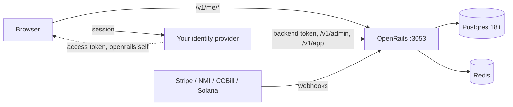

# Standalone OpenRails

OpenRails as its own service, the `openrails` server, that your app calls over
HTTP. [`examples/standalone`](../examples/standalone) runs all of it: the server
from its image, a merchant from a file, an app whose AuthKit is the trusted issuer,
SCIM contacts, receipts and webhooks.



## Run it

The server is the image `docker.io/openrails/openrails:vX.Y.Z` (amd64, arm64) and
the `openrails` binary on each GitHub release. It needs PostgreSQL 18; Redis for
more than one instance; Vault optionally ([operations](operations.md#requirements)).

```yaml
openrails:
  image: docker.io/openrails/openrails:vX.Y.Z
  command: [run-server, --config, /etc/openrails/config.yaml, --merchant-manifest, /etc/openrails/merchant.yaml]
  volumes:
    - ./openrails:/etc/openrails:ro
    - openrails-keys:/vault/auth # auth.keys.path
```

```sh
DB_URL=postgres://… AUTH_KEYS_PATH=… ./openrails run-server --config config.yaml --merchant-manifest merchant.yaml
```

Locally, `task docker-up` runs PostgreSQL, Redis and the server on
`127.0.0.1:3053` (Postgres `:5434`, Redis `:6380`). Every route and webhook shares
the one public port; `private_port` serves `/metrics`. On Kubernetes use the Helm
chart ([kubernetes](kubernetes.md)).

`config.yaml` holds the process; the example's
[`config.yaml`](../examples/standalone/openrails/config.yaml) is complete. Every key
reads from the environment too (`DB_URL` is `db.url`), flags beat the environment,
which beats YAML ([configuration](configuration.md)). Required: an explicit
`provider_write_mode`; a database (`db.url`, or `db.host`, `db.port`,
`db.database`, `db.username`, with `db.sslmode` defaulting to `require`);
`auth.default_tenant_id`; `auth.token.issuer` (https in production);
`auth.resource.id` to accept trusted issuers' tokens; and `trusted_proxies` behind
a load balancer, or `auth.http.direct_peer_ip: true`. An unknown variable inside a
section refuses boot, except those Kubernetes adds per Service
(`REDIS_SERVICE_HOST`, `DB_PORT=tcp://…`).

The server migrates at boot (`openrails migrate up` can run first), replicas take
turns, and a failed migration crash-loops the new version while the old serves.
`run-server` also runs workers; split them with `run-worker` and
`run-server --no-workers` ([several instances](operations.md#several-instances)).

## The merchant

The merchant manifest is the merchant's configuration, read at every boot (the
first creates it) and held read-only in memory. It holds secrets: keep it out of
version control, or render them as [overlays](configuration.md#merchant-configuration-in-a-file).

```yaml
version: 1
merchants:
  onlydemo:
    display_name: OnlyDemo
    remote_application:            # your app's AuthKit: its tokens act for this merchant only
      issuer: http://localhost:8080
      jwks_uri: http://localhost:8080/.well-known/jwks.json
    profile:
      from_email: billing@onlydemo.example
    psps:
      nmi-sandbox:
        rail: nmi
        environment: sandbox       # live (the default), test or sandbox
        gateway_id: "000000"
        tokenization_key: your-public-tokenization-key
        secrets:
          security_key: your-private-security-key
          webhook_signing_secret: your-webhook-signing-key
```

Fields: [merchant configuration](merchant-configuration.md). With `vault.kv_mount`
and `route_groups.merchant_config`, Vault holds the configuration instead and the
manifest names only the merchant and its `remote_application` ([Vault](vault.md)).
Apply the catalog once the server is up, and again when it changes:

```sh
openrails catalog apply catalog.yaml --config config.yaml --merchant-manifest merchant.yaml --merchant onlydemo
```

`route_groups` turns on `admin`, `catalog`, `merchant_config`, `metrics` and
`programmatic` (`/v1/app`, SCIM included), as `RouteGroups` does embedded. Staff
use the console at `/admin` ([billing admin](billing-admin.md)): sign-in at a
trusted issuer through `admin_console.issuers`, or local accounts with
`local_sign_in`. An empty install with local accounts runs
`push-auth-bootstrap` first ([commands](operations.md#commands)).

## Trust your app's AuthKit

The server keeps no accounts of its own: a merchant's trusted issuer mints the
tokens it accepts ([trusted issuers](auth.md#trusted-issuers)). Register the server
as a resource and two clients, one public for browsers (token exchange, DPoP) and
one confidential for your backend:

```go
AuthorizationServer: authkit.AuthorizationServerConfig{
	Resources: []authkit.ResourceServerConfig{{
		ID:            s.OpenRailsURL,                                   // the tokens' aud
		Scopes:        []string{"openrails:self", "openrails:merchant"},
		Permissions:   []string{"merchant:customer:read", "merchant:entitlements:read", "merchant:catalog:read"},
		ContactClaims: true,                                             // contacts for a brand-new buyer
	}},
	Clients: []authkit.OAuthClientConfig{{
		ID: "courses-web", Origins: []string{s.PublicURL}, Resources: []string{s.OpenRailsURL},
		GrantTypes: []authkit.OAuthGrantType{authkit.GrantTokenExchange},
	}, {
		ID: "courses-backend", SecretSHA256: hex.EncodeToString(secret[:]), Resources: []string{s.OpenRailsURL},
		Permissions: []string{"merchant:customer:read", "merchant:entitlements:read", "merchant:catalog:read"},
		GrantTypes:  []authkit.OAuthGrantType{authkit.GrantClientCredentials},
	}},
},
```

The backend's role decides what it may do; grant only what it needs:

| Purpose | Permission |
|---|---|
| read or change the catalog | `merchant:catalog:read`, `merchant:catalog:manage` |
| read or change configuration (and billing archives) | `merchant:config:read`, `merchant:config:manage` |
| inspect, or record usage and running charges | `merchant:usage:read`, `merchant:usage:manage` |
| check entitlements | `merchant:entitlements:read` |
| create orders | `merchant:orders:manage` |
| read or act on customers | `merchant:customer:read`, `merchant:customer:manage` |

Declared roles: `viewer` (read-only), `support` (customers), `owner`. A person's
token is refused on `/v1/app`.

## Backend

The same `*openrails.Client` as embedded, over HTTP:

```go
token, err := openrails.NewClientCredentialsTokenProvider(openrails.ClientCredentialsConfig{
    TokenURL: "https://issuer.example/oauth2/token", ClientID: id, ClientSecret: secret,
    Resource: "https://billing.example.com", // auth.resource.id; scope openrails:merchant by default
})
if err != nil { return err }
client, err := openrails.NewRemoteMerchant("https://billing.example.com",
    openrails.RemoteCredential{Token: token}, // or APIKey: a merchant API key
    openrails.RemoteMerchantOptions{Timeout: 10 * time.Second})
if err != nil { return err }
if _, err := client.GetAdminAccess(ctx); err != nil { return err } // authenticated boot probe
```

The token provider implements client credentials (`client_secret_basic`, RFC 8707
`resource`), caches tokens until shortly before expiry and shares them between
callers; it never follows redirects, logs or persists tokens. `Timeout` bounds the
whole request, token included. A `RemoteCredential` is exactly one of `Token`,
`APIKey`; `NewRemote` with `RemoteOptions.Credentials` serves several merchants.
Constructors do no I/O; `GetPublicConfig` reads `GET /v1/config` without the
credential, and `GetAdminAccess` reports `admin`, `catalog`, `merchant_config`
(`none`, `read`, `update`), `metrics`, `application_permissions` and `scope_id`.

**Errors** are the same sentinels embedded and remote (`errors.Is`):
`ErrUnauthorized`, `ErrInvalid`, `ErrDenied`, `ErrNotFound`, `ErrConflict`,
`ErrInsufficientCredits`, `ErrPaymentRefused`, `ErrInternal` and `ErrUnreachable`
(transport failures, timeouts, 5xx); each server error is a `*StatusError` with the
status and code ([errors](api/errors.md)). For admission, honor every clean deny and
decide per endpoint whether `ErrUnreachable` fails open or closed; keep the
deadline short.

### Cache entitlement checks

For a backend using a merchant API key, set
`RemoteMerchantOptions.EntitlementCheckCache` (or the same field on
`RemoteOptions`) to opt in:

```go
client, err := openrails.NewRemoteMerchant(billingURL,
    openrails.RemoteCredential{APIKey: apiKey},
    openrails.RemoteMerchantOptions{
        EntitlementCheckCache: openrails.EntitlementCheckCacheOptions{
            MaxAge: 30 * time.Second,
        },
    })
```

`CheckEntitlements` caches exact-key checks for the present in bounded process
memory. If you supply your own go-redis client as `EntitlementCheckCache.Redis`,
replicas using the same OpenRails endpoint, merchant and API key can share the
answers. Your backend owns that Redis client and its connection lifecycle.

An answer can be reused for up to `MaxAge` and expires by the next scheduled
access change. A new purchase, early revocation or API key permission change
can take up to `MaxAge` to appear. Call `CheckEntitlementsLive` when you require a
fresh decision. Prefix or historical requests, token-backed credentials and
servers without cache metadata use live checks. Redis failures also fall back
to OpenRails. See [entitlement windows](entitlements_timeline.md#reading-access).

**Customer tokens.** A backend whose signing key is registered as the merchant's
application sets `RemoteCredential.Assertion` (issuer, `kid`, a `crypto.Signer`,
the token endpoint): `CustomerToken` redeems an RFC 7523 assertion for a short
`openrails:self` token, `CustomerAssertion` only signs. An API key alone cannot
sign customer tokens, and an application registered only for assertions holds no
billing role.

Any other stack calls the same routes with its application token:

```bash
curl -X POST https://billing.example.com/v1/app/admissions -H "Authorization: Bearer $TOKEN" \
  -d '{"items":[{"customer_id":"…","invoker":"user-123","request_id":"req-789",
       "usage":{"event_type":"chat","dimensions":{"input_tokens":4000,"output_tokens":1000}},
       "expires_at":"2026-09-16T12:00:00Z"}]}'
```

The remote CLI reads a token from `--token-file` on every call:
`openrails get-merchant-config --server-url https://billing.example.com --token-file token`.

## Browser

The browser calls the server directly with a DPoP-bound `openrails:self` token
from token exchange; your session never leaves your domain ([frontend](frontend.md)):

```ts
export const auth = createAuthClient({ resourceTokens: { clientId: "courses-web" } })
const server: { base_url: string; resource: string } = await fetch("/api/billing").then((r) => r.json())
export const billing = createBillingClient({
  baseUrl: server.base_url,
  fetch: (input, init) =>
    auth.getAccessToken()
      ? auth.resourceFetch(input, { ...init, resource: server.resource, scope: "openrails:self" })
      : fetch(input, init),
})
```

## Contacts, receipts and webhooks

- **Contacts.** Your AuthKit pushes users to the server's directory over SCIM
  (`Provisioning.Targets` with the backend's client credentials), or its tokens'
  verified contact claims fill a new buyer. AuthKit shares only proven emails, so
  require verification and give it a sender ([customer contacts](customer-contacts.md)).
- **Receipts.** OpenRails records billing facts; your app renders and sends
  receipts from `Client.ListEvents` or `GET /v1/app/events` ([events](events.md)).
- **Webhooks.** Point each PSP at `https://<server>/v1/webhooks/{rail}/{account_id}`
  (the NMI example: `/v1/webhooks/nmi/000000`), not through your app; locally
  through a tunnel ([local webhooks](dev/local-webhooks.md)).
- **Paying off your site:** [payment page](payment-page.md).

Products serving many merchants build on the [server package](server-package.md).
